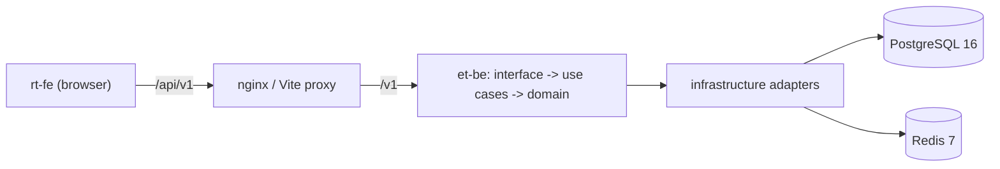

# et-be

**Production-grade REST API built on Express 5 and TypeScript, following Clean Architecture,
backed by PostgreSQL 16 (Prisma 7) and Redis 7.**


<!-- CI badge (set once the repository exists):
 -->

## Table of contents

1. [Overview](#overview)
2. [Features](#features)
3. [API reference](#api-reference)
4. [Architecture](#architecture)
5. [Tech stack](#tech-stack)
6. [Getting started](#getting-started)
7. [Configuration](#configuration)
8. [Scripts](#scripts)
9. [Project structure](#project-structure)
10. [Testing](#testing)
11. [CI/CD and branching](#cicd-and-branching)
12. [Deployment](#deployment)
13. [Security](#security)
14. [Contributing](#contributing)
15. [Documentation](#documentation)

## Overview

et-be is the backend of the fs-reustemp full-stack workspace. It exposes a versioned JSON API under
`/v1`, consumed by the rt-fe single-page application through a same-origin reverse proxy.

- **Clean Architecture**, enforced by lint: domain and use cases never depend on frameworks.
- **Secure by default**: httpOnly cookie sessions, rotating refresh tokens with reuse detection,
  double-submit CSRF, Redis-backed rate limiting, helmet, strict CORS, zod validation, presenters.
- **Operable**: structured logs with request ids, liveness and readiness probes, graceful shutdown,
  non-root container, Prisma Migrate.
- **Contract-first**: every endpoint implements an OpenAPI contract; the exported spec is checked in CI.

## Features

<!-- AUTO-GENERATED:FEATURES:START -->
<!-- Do not edit by hand: generated by `npm run docs:readme` from docs/. -->

| Feature | Status | Since | Summary | Endpoints |
|---|---|---|---|---|
| [API platform foundation](docs/features/platform.md) | in-progress | - | Validated config, structured logging with request ids, the error envelope, Postgres + Redis adapters with readiness probes, rate limiting and the feature-module registry. | - |
| [Authentication](docs/features/auth.md) | planned | - | Email + password sign-in with httpOnly cookie sessions, rotating refresh tokens, reuse detection and double-submit CSRF. | `POST /v1/auth/login`<br>`POST /v1/auth/refresh`<br>`POST /v1/auth/logout`<br>`GET /v1/auth/whoami` |

<!-- AUTO-GENERATED:FEATURES:END -->

Feature pages: [docs/features/](docs/features/). Release history: [CHANGELOG.md](CHANGELOG.md).

## API reference

<!-- AUTO-GENERATED:API:START -->
<!-- Do not edit by hand: generated by `npm run docs:readme` from docs/. -->

_The exported spec contains no operations yet._

<!-- AUTO-GENERATED:API:END -->

Interactive documentation is served at `/api-docs` (spec at `/api-docs.json`) in non-production
environments. Error responses always use `{ "error": string, "code": string, "details"?: object }`;
lists use cursor pagination `{ "items": [], "nextCursor": string | null }`.

## Architecture



| Layer | Responsibility |
|---|---|
| `domain/` | Entities, invariants, ports, error catalog - no framework code |
| `use-cases/` | One class per action, single `execute()` |
| `infrastructure/` | Prisma repositories, Redis, JWT, bcrypt, pino |
| `interface/` | Routes, controllers, middlewares, zod schemas, presenters |
| `modules/` + `app.ts` + `server.ts` | Composition root and process lifecycle |

Details: [docs/architecture.md](docs/architecture.md).

## Tech stack

| Concern | Choice |
|---|---|
| Runtime / language | Node.js 22, TypeScript 5.9 (strict, CommonJS build) |
| HTTP | Express 5, helmet, cors, cookie-parser, express-rate-limit + rate-limit-redis |
| Data | PostgreSQL 16, Prisma 7 (`prisma-client` generator, `@prisma/adapter-pg`), Prisma Migrate |
| Cache / sessions | Redis 7 (ioredis) |
| Auth | jsonwebtoken, bcrypt |
| Validation | zod |
| Logging | pino, pino-http |
| API docs | OpenAPI 3 + swagger-ui-express |
| Tests | Jest, ts-jest, supertest |
| Quality | ESLint 9 (typescript-eslint, boundaries, import), Prettier |
| Delivery | Docker (multi-stage, non-root), docker compose, GitHub Actions, GHCR, Trivy, CodeQL, gitleaks |

## Getting started

**Prerequisites:** Node.js 22 (`.nvmrc`), Docker with compose.

```bash
cp .env.example .env                 # then set real secrets
npm install                          # creates package-lock.json - commit it
npx prisma generate
docker compose up -d postgres redis
npm run db:migrate                   # apply migrations to the local database
npm run dev                          # http://localhost:4000/health
```

## Configuration

Validated at boot by `src/config/env.ts`. Main variables: `DATABASE_URL`, `REDIS_URL`,
`JWT_ACCESS_SECRET`, `JWT_REFRESH_SECRET`, `CORS_ORIGINS`, `COOKIE_SECURE`, `COOKIE_DOMAIN`.
Full reference and local ports: [docs/configuration.md](docs/configuration.md).

## Scripts

| Script | Purpose |
|---|---|
| `npm run dev` | Start with hot reload (nodemon + ts-node) |
| `npm run build` / `npm start` | Compile to `dist/` / run the compiled server |
| `npm run verify` | **Local pipeline** (lint, typecheck, tests, docs check) - run before every push |
| `npm run lint` / `npm run typecheck` | ESLint (zero warnings) / TypeScript |
| `npm test` (`test:unit`, `test:integration`, `test:e2e`) | Jest suites |
| `npm run db:migrate` / `db:deploy` / `db:status` | Prisma Migrate (dev / deploy / status) |
| `npm run db:provision-roles` / `db:seed-admin` | Least-privilege DB roles / first admin user |
| `npm run docs:export` | Write `docs/openapi.json` from the OpenAPI definition |
| `npm run docs:readme` / `docs:check` | Regenerate / verify the generated README sections |

## Project structure

```
src/
  server.ts, app.ts       composition root (process, wiring)
  modules/                feature modules (one per feature) + registry
  config/                 environment loader
  domain/                 entities, ports, errors, constants
  use-cases/<feature>/    application logic
  infrastructure/         database, repositories, security, cache, services, realtime (optional)
  interface/              controllers, routes, middlewares, validation, presenters
  docs/                   OpenAPI definition
prisma/                   schema + migrations
tests/                    unit, integration, e2e, smoke, fixtures, helpers
scripts/                  operational and documentation scripts
docs/                     architecture, configuration, feature pages, generated openapi.json
docker/                   database init scripts
```

## Testing

| Suite | Scope | Needs |
|---|---|---|
| `tests/unit` | Use cases and domain rules with in-memory doubles | nothing |
| `tests/integration` | Repositories and adapters | PostgreSQL + Redis |
| `tests/e2e` | HTTP routes through the real app (supertest) | PostgreSQL + Redis |
| `tests/smoke` | Boot + `/health`, `/ready` | PostgreSQL + Redis |

Conventions: [tests/README.md](tests/README.md).

## CI/CD and branching

- One branch per task: `feature/`, `fix/`, `refactor/`, `perf/`, `test/`, `docs/`, `chore/`, `ci/` from `dev`;
  `hotfix/` from `main`. Commits: `type(<task>): summary`.
- Push to a work branch: **verify** (lint, typecheck, tests with PostgreSQL + Redis, boundaries report,
  dependency audit, secret scan, OpenAPI drift, README docs check), then a PR into `dev` with auto-merge.
- Pull requests: verify + Docker build and Trivy scan. `main`: verify + image published to GHCR
  (`sha-<commit>`, `latest`, semver tags). Weekly CodeQL. `dev` -> `main` promotion is a manual workflow.

## Deployment

The runtime image runs `node --enable-source-maps dist/server.js` as a non-root user. Apply migrations
before starting new instances (`prisma migrate deploy`, the compose `migrate` service shows the pattern).
Probes: liveness `GET /health`, readiness `GET /ready`. Instances are stateless and scale horizontally.

## Security

Cookie-based sessions (no tokens in JavaScript), rotating refresh tokens with reuse detection, CSRF
double submit, per-concern rate limits, strict CORS allow-list, helmet, body size limits, zod validation,
presenter whitelists, parameterized SQL only, no secrets in code or logs, least-privilege database roles.
Report vulnerabilities privately to the repository owner.

## Contributing

1. Work from a task brief (`contracts/tasks/` in the workspace) on its branch.
2. Follow the file contract in [AGENTS.md](AGENTS.md) and the engineering standards in
   [AGENTS-SENIOR-BACKEND-DB.md](AGENTS-SENIOR-BACKEND-DB.md).
3. Update the feature page in `docs/features/`, add a CHANGELOG line, run `npm run docs:readme`.
4. `npm run verify` must be green before pushing. No AI attribution in commits, branches or PRs.

## Documentation

| Document | Content |
|---|---|
| [docs/README.md](docs/README.md) | Documentation index |
| [docs/architecture.md](docs/architecture.md) | Layers, lifecycle, patterns, decisions |
| [docs/configuration.md](docs/configuration.md) | Environment variables, local services |
| [docs/features/](docs/features/) | One page per feature |
| [CHANGELOG.md](CHANGELOG.md) | Release history |

## License

Proprietary unless the owner adds a `LICENSE` file.
