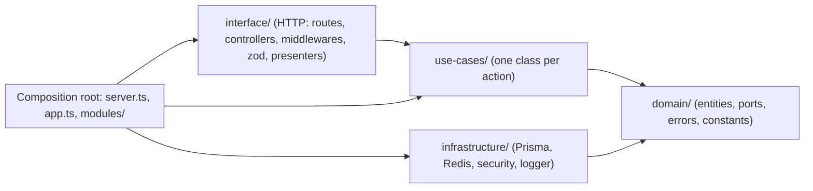

# Architecture

et-be is a modular monolith following Clean Architecture: business rules in the center, frameworks at
the edges, dependencies pointing inward. The rules below are enforced by ESLint
(`eslint-plugin-boundaries` + per-layer import bans), not just by convention. Exhaustive file-level
rules: [../AGENTS.md](../AGENTS.md).

## Layers



| Layer | Responsibility | May import |
|---|---|---|
| `domain/` | Entities, invariants, ports (interfaces), `AppError` + error-code catalog | nothing outside domain |
| `use-cases/` | Application logic, one class per action, `execute()` only | domain |
| `infrastructure/` | Adapters implementing ports: Prisma repositories, Redis, JWT, bcrypt, pino | domain, generated Prisma client |
| `interface/` | HTTP delivery: routes, controllers, middlewares, request schemas, presenters | domain, use-cases |
| `config/` | The only reader of `process.env` (zod-validated) | - |
| Composition root | Builds shared adapters once, wires feature modules, owns process lifecycle | everything |

## Request lifecycle

```
request -> requestContext (X-Request-Id) -> pino-http -> /health, /ready
        -> helmet -> cors -> json(limit) -> cookies -> sanitize -> rate limit -> CSRF
        -> /v1/<feature> router -> [auth] -> [role] -> [validate] -> controller
        -> use case -> ports -> adapters -> entity -> presenter -> JSON
        -> 404 handler -> error handler ({ error, code, details? })
```

## Key patterns

- **Feature modules** (`src/modules/<feature>Module.ts`): each feature wires itself; `app.ts` never changes per feature.
- **Repository + Unit of Work**: one repository per aggregate; multi-aggregate writes through `IUnitOfWork.run()`.
- **Presenters**: explicit response whitelists - entities are never serialized directly.
- **Single error model**: `AppError(code, message, status)` + global handler; codes are a public contract.
- **Ports for cross-cutting concerns**: logger, password hashing, tokens, refresh store, readiness probes.
- **Pragmatic CQRS**: commands go through entities; queries may return read DTOs from dedicated repository methods.

## Cross-cutting decisions

| Topic | Decision | Source |
|---|---|---|
| Auth | httpOnly cookie sessions, rotating refresh tokens, double-submit CSRF | workspace ADR 0002 |
| API shape | `/v1`, `{ error, code }` envelope, cursor pagination | workspace ADR 0003 |
| Scale & tenancy | applied per project profile | `AGENTS-SENIOR-BACKEND-DB.md` section 0.3 |
| Migrations | Prisma Migrate only; additive first | `AGENTS-SENIOR-BACKEND-DB.md` section 2 |

## Runtime topology

```
client -> (rt-fe nginx /api) -> et-be (stateless, N instances) -> PostgreSQL 16
                                                              -> Redis 7 (sessions, rate limits, cache)
```

Health: `/health` (liveness, no I/O), `/ready` (readiness: Postgres + Redis probes).
